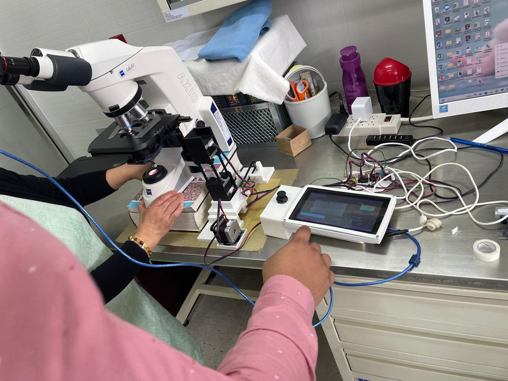
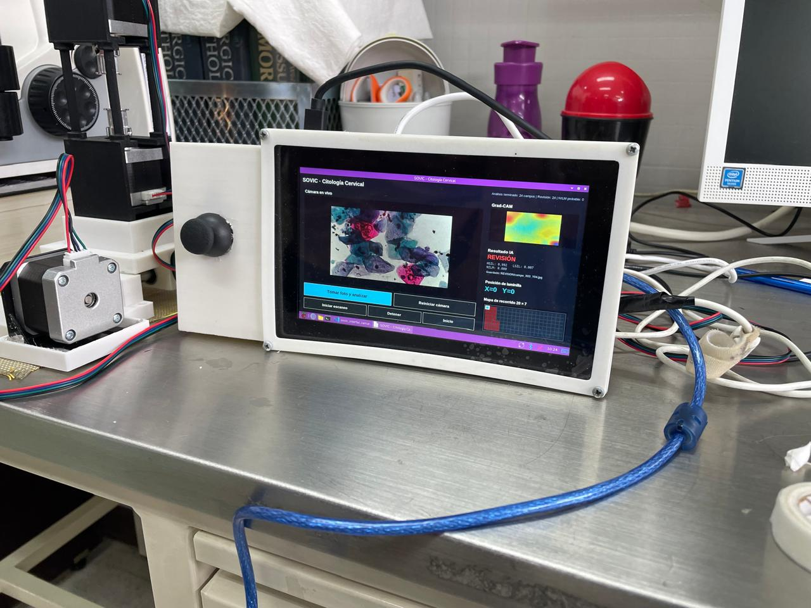
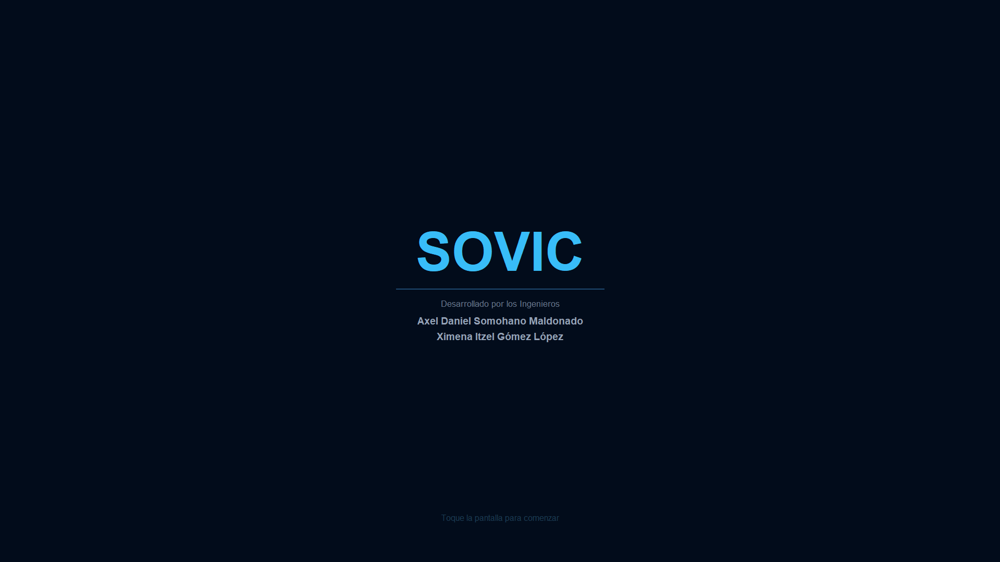
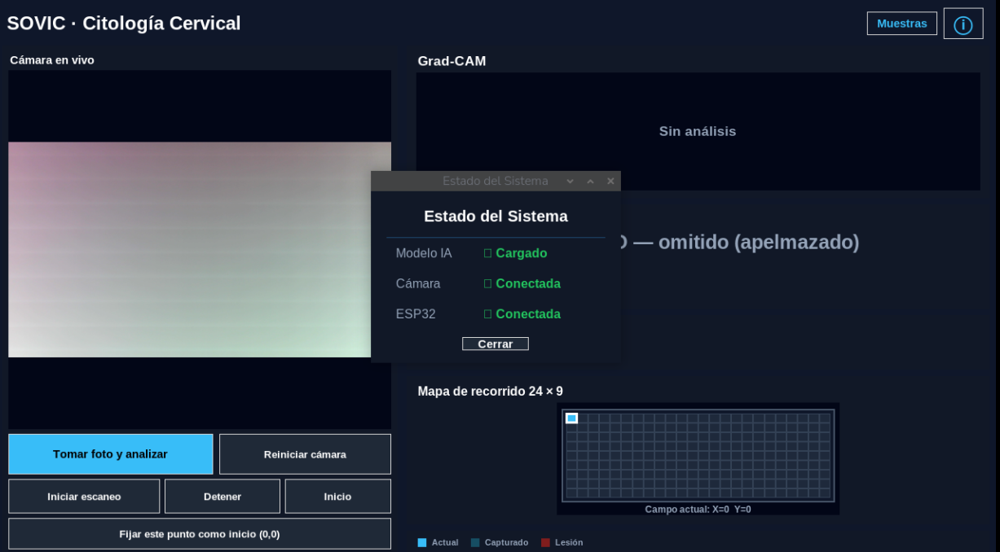
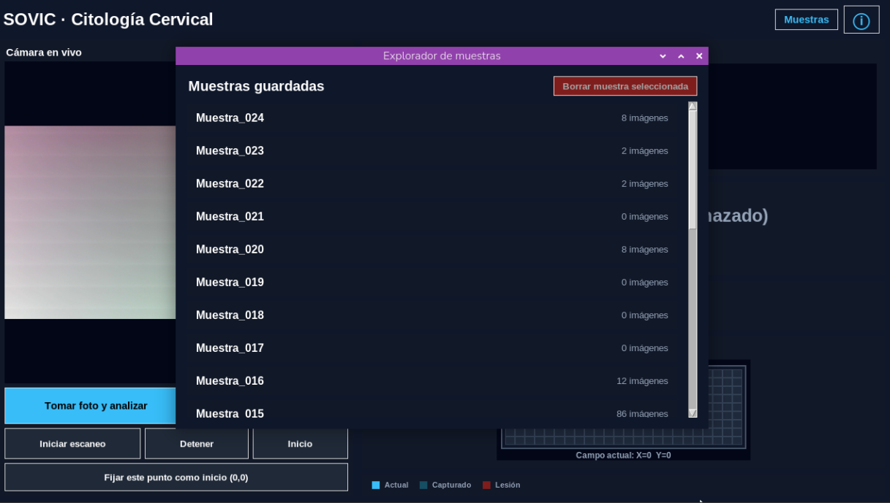
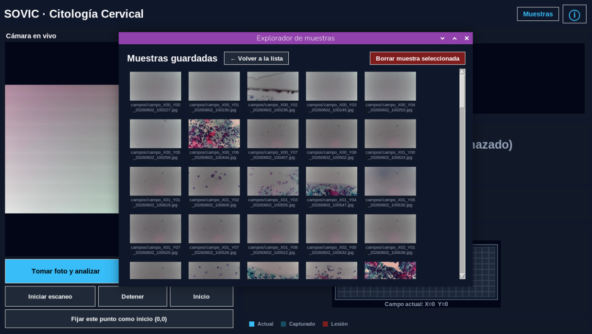
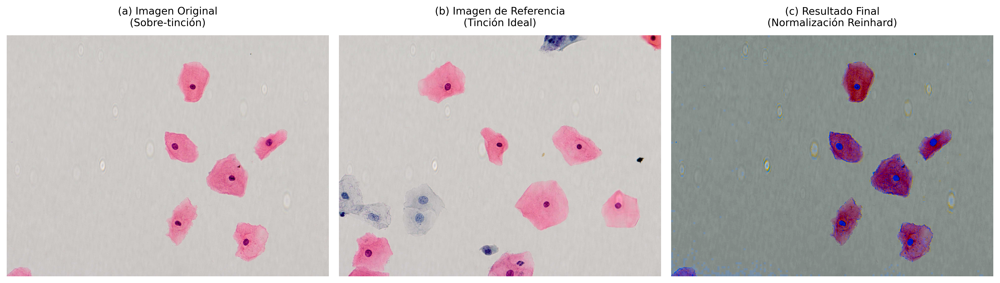
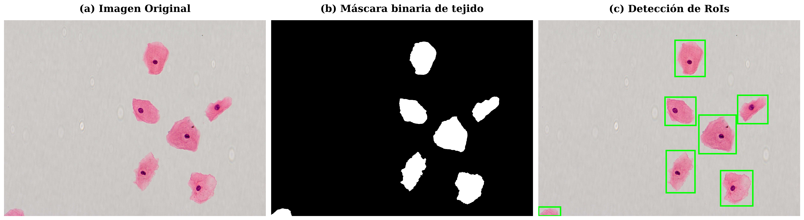

# SOVIC: Sistema Optomecatrónico con Visión Artificial para Clasificación de Lesiones Cervicales (LSIL / HSIL)

---

## ENGLISH VERSION

### Problem & Motivation
In regions with high cervical cancer incidence and limited healthcare resources, medical staff face a massive operational bottleneck: **analyzing thousands of manual Pap smear slides**, where up to 98% of samples are negative (NILM). Manual inspection leads to severe visual fatigue, diagnostic backlogs, and delayed clinical treatments—a critical bottleneck that increases preventable cancer risks.

### System Overview
**SOVIC** (*Sistema Optomecatrónico con Visión Artificial para Clasificación de Lesiones Cervicales*) is an automated, low-cost Point-of-Care (PoC) computer-aided triage system designed to automate the traditional Pap smear screening workflow without requiring modifications to legacy laboratory equipment. 

Rather than replacing the physical microscope, SOVIC non-invasively replicates human operational mechanics and visual analysis through an integrated mechatronic architecture:
- **Optical Acquisition (The Eyes):** A non-invasive universal microscope camera captures real-time high-resolution optical fields.
- **Mechatronic Actuation (The Hands):** Custom 3D-printed mechanical adapters, toothed belts, and NEMA 17 stepper motors physically interface with the microscope stage knobs and focus controls, replicating manual dexterity to scan slide grids systematically.
- **Edge Inference (The Brain):** An edge-optimized Deep Learning model classifies optical fields under Bethesda System criteria (NILM, LSIL, HSIL) and isolates suspicious diagnostic regions instantly.

### System Architecture & Tech Stack

#### Edge Computing & GUI (`Raspberry Pi 5`)
- **Core Unit:** Raspberry Pi 5 (8GB RAM) running a dedicated 7" touchscreen interface.
- **Software Stack:** Python (`Tkinter`, `OpenCV`, `TensorFlow`), optimized with multi-threading and graph compilation caching.
- **Biological Pre-filters:** Evaluates sharpness via Laplacian variance and cellular content using HSV masking and Otsu thresholding prior to inference, automatically discarding empty or blurred fields.

#### Mechatronics & Hardware Control (`ESP32-C3 Mini`)
- **Microcontroller:** ESP32-C3 Mini managing precise step execution via serial USB communication (`/dev/ttyACM0`).
- **Motion Control:** Dual NEMA 17 stepper motors for Y-axis actuation (with follower synchronization) and X-axis motion, supporting manual joystick overrides and automated grid scanning loops.

---

## VERSIÓN EN ESPAÑOL

### Planteamiento del Problema
En regiones con alta incidencia de cáncer cervicouterino y recursos limitados, el personal médico enfrenta un cuello de botella crítico: **el análisis manual de miles de laminillas de Papanicolaou**. Dado que hasta el 98% de las muestras resultan negativas (NILM), la revisión exhaustiva manual genera fatiga visual severa en los citotecnólogos, saturación diagnóstica y retrasos en la entrega de resultados clínicos.

### Descripción del Sistema
**SOVIC** es un sistema mecatrónico de triaje automatizado de bajo costo para puntos de atención (*Point-of-Care*), concebido para automatizar el flujo de trabajo citológico sin alterar el equipo de laboratorio existente.

El sistema replica de forma no invasiva la destreza y capacidad analítica humana mediante la integración de tres subsistemas:
- **Adquisición Óptica:** Una cámara universal para microscopio acoplada al ocular captura los campos ópticos en tiempo real.
- **Actuación Mecatrónica:** Un tren motriz compuesto por adaptadores impresos en 3D, bandas dentadas y motores paso a paso NEMA 17 acoplados a las perillas micrométricas del microscopio, permitiendo un desplazamiento automatizado y continuo sobre toda la muestra.
- **Procesamiento Inteligente:** Un modelo de aprendizaje profundo optimizado en el borde clasifica los campos bajo los criterios del Sistema Bethesda (NILM, LSIL, HSIL) y segrega los casos sospechosos para su revisión especializada prioritaria.

### Arquitectura y Componentes Tecnológicos

#### Interfaz y Procesamiento en el Borde (`Raspberry Pi 5`)
- **Hardware:** Raspberry Pi 5 (8GB RAM) con pantalla táctil integrada de 7".
- **Software:** Aplicación de control desarrollada en Python (`Tkinter`, `OpenCV`, `TensorFlow`), optimizada con concurrencia de hilos y compilación de grafos.
- **Filtros Biológicos Previos:** Verificación de nitidez (varianza del Laplaciano) y densidad tisular (máscaras HSV y umbralización) antes de ejecutar la inferencia de IA.

#### Control Mecatrónico y Hardware (`ESP32-C3 Mini`)
- **Microcontrolador:** ESP32-C3 Mini para la ejecución de pasos mediante protocolo serial USB (`/dev/ttyACM0`).
- **Tracción:** Motores NEMA 17 para el posicionamiento en ejes X e Y (con sincronización dual en el eje Y), habilitando control manual por joystick y modos de escaneo en rejilla automatizados.

---

## System Gallery / Galería del Sistema

### Physical Mounting / Montaje Físico sobre el Microscopio

  
  

<em>Mechatronic integration: motors coupled to microscope knobs, universal camera, and Raspberry Pi 5 in operation. / Integración mecatrónica: motores acoplados a las perillas, cámara universal y Raspberry Pi 5 en operación.</em>

---

### Touch Interface (GUI v8.1) / Interfaz Táctil
| Main Operation View / Vista Principal | System Connections / Conexiones del Sistema |
| :---: | :---: |
|  |  |

| Sample Explorer / Explorador de Muestras | Saved Folders Management / Gestión de Archivos |
| :---: | :---: |
|  |  |

---

### Computer Vision Pipeline / Pipeline de Visión por Computadora

- **Chromatic Standardization (Reinhard) / Normalización Cromática:** Standardizes staining brightness and illumination to prevent bias across different laboratories. *(Estandariza la iluminación y el brillo de las tinciones para evitar sesgos entre laboratorios).*
  

    
  

- **Segmentation & Safe Crop / Segmentación y Recorte Seguro:** Isolates cellular components of interest while discarding slide background artifacts. *(Aisla los componentes celulares de interés descartando el fondo blanco del portaobjetos).*
  

    
  

---

## Clinical Validation & Performance / Validación Clínica y Desempeño

To measure real-world operational efficacy, SOVIC was evaluated against a blind trial dataset of **700 Pap smear samples** compared with expert pathological ground truth.

*Para medir la eficacia operativa en entornos reales, SOVIC fue evaluado frente a un conjunto de prueba ciego de **700 muestras de Papanicolaou** contrastadas con el estándar de referencia histopatológico.*

### Performance Metrics (700-Sample Trial) / Métricas de Desempeño

| Metric / Métrica | Value / Valor | Clinical Significance / Significado Clínico |
| :--- | :---: | :--- |
| **Accuracy / Exactitud Global** | **89.00%** | Overall concordance with pathological standard (623/700 correct). / Coincidencia general con el estándar patológico. |
| **Sensitivity / Sensibilidad** | **96.01%** | Critical for triage: minimizes false negatives on lesion samples (LSIL/HSIL). / Crucial en triaje: minimiza falsos negativos en lesiones. |
| **Specificity / Especificidad** | **76.31%** | Correct negative sample isolation (NILM/NLM). / Correcta segregación de muestras negativas. |
| **Precision (PPV) / Valor Predictivo** | **88.01%** | Reliability of positive lesion predictions. / Confiabilidad de predicciones positivas. |

* **Key Takeaway / Conclusión clave:** High sensitivity (**96.01%**) ensures that potential pre-cancerous or malignant lesions are reliably caught during automated triage, drastically reducing the risk of missed diagnoses in primary care workflows. / La alta sensibilidad asegura que las lesiones potenciales sean detectadas de forma confiable durante el triaje automatizado, reduciendo drásticamente el riesgo de diagnósticos omitidos.

---

## Author & Developer / Autor y Desarrollador
- **Ing. Axel Daniel Somohano Maldonado** — *Mechatronics, Embedded Systems, Hardware & Software Architecture*
